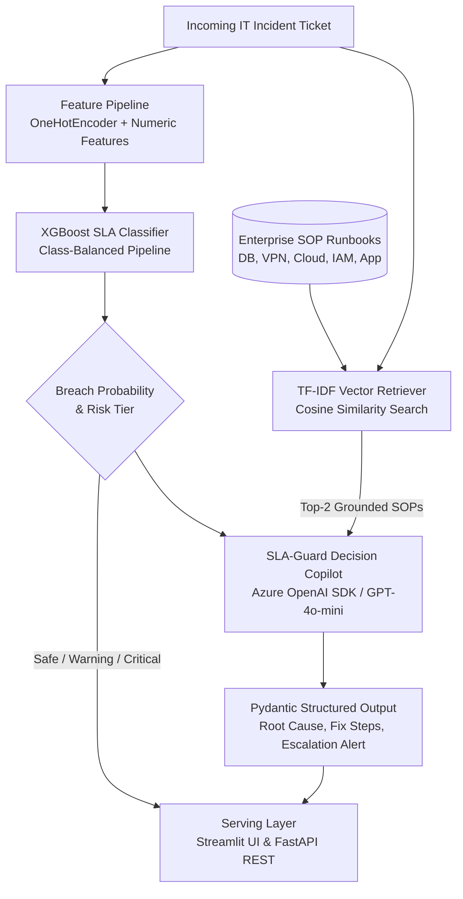

# SLA-Guard Copilot
**Enterprise IT Ops Predictive Analytics & Azure OpenAI Decision Suite**

[](https://sla-guard-copilot-u8hshu5yz6wrafptwdqvvx.streamlit.app/)
[](https://www.python.org/)
[](https://xgboost.readthedocs.io/)
[](https://fastapi.tiangolo.com/)
[](https://learn.microsoft.com/en-us/azure/ai-services/openai/)

> **Live Interactive App:** [https://sla-guard-copilot-u8hshu5yz6wrafptwdqvvx.streamlit.app/](https://sla-guard-copilot-u8hshu5yz6wrafptwdqvvx.streamlit.app/)

---

## 1. Business Problem & Solution

Enterprise IT Operations teams manage thousands of incidents across Databases, Networks/VPN, Cloud Infrastructure, IAM, and Application services. Traditional ticketing workflows are **reactive** -- engineers only discover SLA violations after deadlines are already missed, resulting in escalations, downtime, and financial penalties.

**SLA-Guard Copilot** shifts IT Operations from reactive firefighting to **proactive incident prevention** by combining two tightly integrated engines:
1. **Predictive SLA Risk Engine:** Estimates real-time SLA breach probability the moment a ticket enters the queue using a class-balanced XGBoost pipeline.
2. **RAG-Grounded SRE Decision Copilot:** Retrieves matching enterprise IT Standard Operating Procedures (SOPs) and uses an Azure OpenAI-compatible LLM (`gpt-4o-mini`) to generate structured root-cause hypotheses, step-by-step diagnostics, escalation routing, and executive alert drafts.

---

## 2. End-to-End System Architecture & Workflow



### Detailed Execution Workflow

1. **Data & Knowledge Base Generation (`src/generate_data.py`):**
   - Generates **5,000 realistic ITSM tickets** across 4 SLA tiers (`P1 - 4h`, `P2 - 8h`, `P3 - 24h`, `P4 - 48h`), 5 incident categories, and 5 support groups (`L1-ServiceDesk`, `L2-InfraOps`, `L3-DBA`, `L2-NetOps`, `SecOps`).
   - Models real-world operational breach drivers including queue backlog, ticket reassignment loops, off-hours arrival, and weekend shifts.
   - Creates 5 structured enterprise IT SOP runbooks under `data/runbooks/`.

2. **Predictive ML Pipeline (`src/train_model.py`):**
   - Uses a unified Scikit-learn `Pipeline` with `ColumnTransformer` (`OneHotEncoder` for categorical fields + passthrough for operational metrics) to guarantee zero train/serve skew.
   - Trains a class-balanced `XGBClassifier` (`scale_pos_weight`) with stratified 80/20 splitting.
   - Exports the serialized model (`models/sla_model.pkl`) along with Precision, Recall, F1-Score, ROC-AUC, and top feature importances (`models/metrics.json`).

3. **Lightweight RAG Retrieval & Decision Engine (`src/copilot.py`):**
   - **Low-Memory Cloud Retrieval:** Indexes SOP runbooks using unigram/bigram `TfidfVectorizer` and cosine similarity for sub-second lookup without heavy GPU/PyTorch memory overhead on 1 GB cloud containers.
   - **Strict Schema Validation:** Enforces Pydantic (`CopilotAdvice`) validation so the LLM always returns clean fields: `root_cause_hypothesis`, `immediate_action_steps`, `recommended_escalation_team`, `manager_alert_draft`, and `cited_runbook`.

4. **Dual-Mode Serving & Auto-Bootstrapping (`src/api.py` & `app/dashboard.py`):**
   - Exposes REST endpoints via FastAPI for external ITSM integrations (ServiceNow/Jira webhooks).
   - Serves a 3-tab Streamlit + Plotly executive dashboard with automatic data/model bootstrapping on fresh cloud deployments.

---

## 3. Dual-Mode Azure OpenAI & Resilience Architecture

The copilot uses an adapter pattern on top of the official OpenAI/Azure SDK, enabling zero-code-change switching between enterprise cloud environments and zero-cost portfolio hosting:

| Priority Tier | Engine Mode | Configuration Trigger | Purpose |
| :--- | :--- | :--- | :--- |
| **Tier 1 (Enterprise)** | **Azure OpenAI Service** | `LLM_PROVIDER=azure` + Azure Endpoint & Key | Production enterprise deployment with private Azure compliance |
| **Tier 2 (Live Demo)** | **Azure-Hosted GitHub Models (`gpt-4o-mini`)** | `GITHUB_TOKEN` (Models Read-Only) | Zero-cost live cloud demo hosted on Azure AI inference |
| **Tier 3 (Backup LLM)** | **Groq Cloud (`llama-3.3-70b-versatile`)** | `GROQ_API_KEY` | High-speed open-weights fallback |
| **Tier 4 (Zero-Downtime)** | **Deterministic SOP Engine** | Automatic on missing key or API timeout | Parses matched runbooks directly so the UI never crashes |

---

## 4. Application Walkthrough

- **Tab 1 -- Ops Command Center:** Executive KPIs (Total Tickets, SLA Compliance %, Breach Rate, Avg Resolution Time, ROC-AUC/F1), Category Breach Rate bar chart, Team vs. Priority Breach Heatmap, and XGBoost Feature Importance breakdown.
- **Tab 2 -- Live Breach Predictor & Copilot:** Interactive incident simulator with real-time Plotly Risk Gauge (`Safe` < 40%, `Warning` 40-70%, `Critical` >= 70%), SOP-cited Root Cause Hypothesis, 4 technical remediation steps, target escalation team, and a copy-ready Manager Escalation Alert.
- **Tab 3 -- SOP Runbook Q&A:** Direct conversational search over indexed IT SOPs with explicit source citations.

---

## 5. FastAPI Microservice Endpoints

Launch Swagger UI locally at `http://127.0.0.1:8000/docs` via `uvicorn src.api:app --reload`.

| Method | Endpoint | Description |
| :--- | :--- | :--- |
| `GET` | `/health` | Returns API status, ML model load state, and active LLM backend |
| `POST` | `/predict-sla` | Accepts ticket metadata and returns `breach_probability_pct` and `risk_level` |
| `POST` | `/copilot/advise` | Runs SLA prediction + RAG runbook retrieval + structured AI mitigation plan |

**Sample Request (`POST /copilot/advise`):**
```json
{
  "priority": "P1 - Critical",
  "category": "Database & SQL",
  "assigned_group": "L1-ServiceDesk",
  "open_tickets_in_queue": 45,
  "reassignment_count": 2,
  "created_hour": 22,
  "is_weekend": 0,
  "sla_target_hours": 4,
  "description": "Production PostgreSQL reporting database experiencing severe lock contention and 92% connection pool saturation."
}
```

---

## 6. Project Structure

```text
sla-guard-copilot/
??? app/
?   ??? dashboard.py            # 3-tab Streamlit & Plotly Executive UI
??? data/
?   ??? raw_tickets.csv         # 5,000 generated enterprise ITSM tickets
?   ??? runbooks/               # 5 indexed IT SOP runbooks (.txt)
??? models/
?   ??? sla_model.pkl           # Serialized Scikit-learn + XGBoost pipeline
?   ??? metrics.json            # Evaluation metrics & top feature importances
??? src/
?   ??? __init__.py
?   ??? generate_data.py        # Synthetic ITSM dataset & SOP generator
?   ??? train_model.py          # Model training, evaluation & artifact export
?   ??? copilot.py              # TF-IDF RAG Retriever & Azure-compatible Copilot
?   ??? api.py                  # FastAPI microservice endpoints
??? .gitignore
??? requirements.txt
??? README.md
```

---

## 7. Quick Start (Local & Cloud)

### Local Setup (Windows PowerShell)
```powershell
git clone [https://github.com/rajnishkumar-18/sla-guard-copilot.git](https://github.com/rajnishkumar-18/sla-guard-copilot.git)
cd sla-guard-copilot

python -m venv venv
.\venv\Scripts\Activate.ps1
pip install -r requirements.txt

# 1. Generate dataset & runbooks
python src/generate_data.py

# 2. Train XGBoost SLA model
python src/train_model.py

# 3. Launch Executive Dashboard
streamlit run app/dashboard.py
```

### Environment Configuration (`.env` or Streamlit Cloud Secrets)
```toml
LLM_PROVIDER = "github_models"
GITHUB_TOKEN = "your_github_models_token"

# Optional Enterprise Azure OpenAI Override:
# LLM_PROVIDER = "azure"
# AZURE_OPENAI_API_KEY = "your_azure_key"
# AZURE_OPENAI_ENDPOINT = "[https://your-resource.openai.azure.com/](https://your-resource.openai.azure.com/)"
# AZURE_OPENAI_DEPLOYMENT = "gpt-4o-mini"
```

---

## 8. Future Enhancements

- **Live ITSM Connectors:** Webhook ingestion from ServiceNow / Jira Service Management for automated ticket triage.
- **SHAP Explainability:** Per-ticket local SHAP waterfall charts showing exact contribution of queue load vs. priority.
- **Persistent Audit Logging:** PostgreSQL/Neon telemetry logging for historical prediction drift monitoring and escalation tracking.
